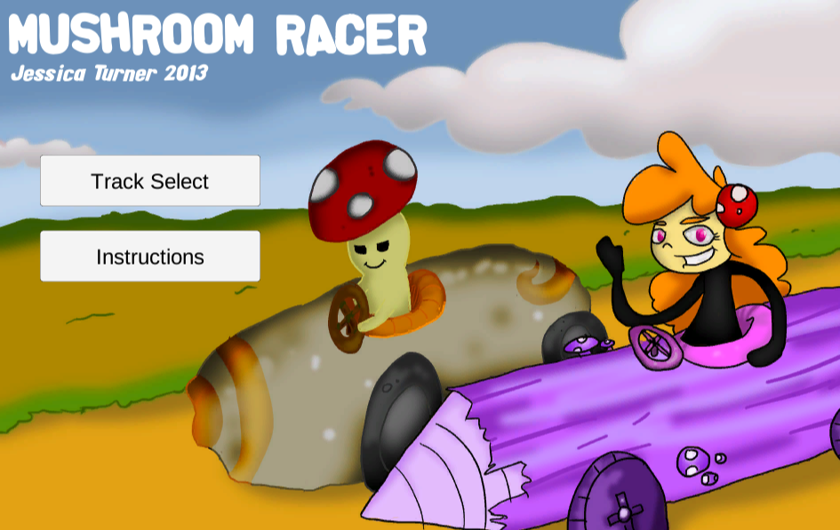
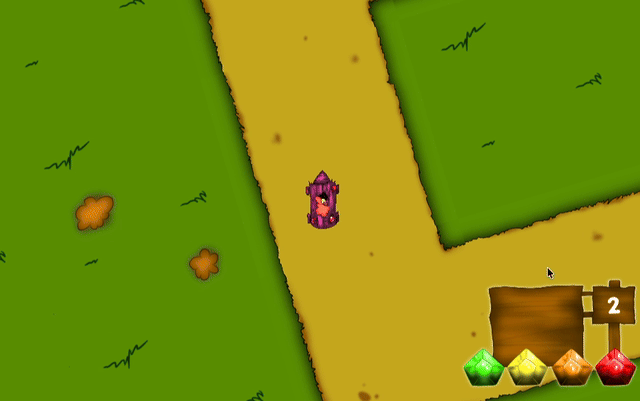

# Mushroom Racer

A top-down, 2D-style racing game built in Unity. You play Briar Tomestone, racing the arrogant Prince Ted Toadstool through bright, cartoonish forest tracks to qualify for the Toadstool Grand Prix. First to finish three laps wins, and pickups can be used to slow your rival down.

**Status:** Complete. This project is archived and no longer maintained.

**[Play it in your browser on itch.io](https://jesyikaturner.itch.io/mushroom-racer)**





## About

Mushroom Racer was originally made in 2013 as a university project. I later brought it up to Unity 2019 with a new UI and released it on itch.io. It's a finished, playable game, but it's not polished. See [Known issues](#known-issues) for an honest look at what I'd change.

## Features

- 4 race tracks plus a main menu with instructions and track select
- Lap and checkpoint tracking
- An AI rival that follows waypoints
- Boosts, power-ups, traps and projectiles
- Health, lap and power-up HUD, plus pause and race-finished screens

## Controls

| Action | Input |
|---|---|
| Turn | `A` / `D` or `Left` / `Right` |
| Accelerate | `W` or `Up` |
| Reverse | `S` or `Down` |
| Use item | Left click, `Space` or `Enter` |
| Pause | `P` |

## Running the project

Requires **Unity 2019.4.0f1** (the version in `ProjectSettings/ProjectVersion.txt`).

1. Clone the repo.
2. Open the folder in Unity Hub with Unity 2019.4.
3. Open `Assets/Scenes/NewMainMenu.unity` and press Play.

Or just play it in your browser on itch.io (free, web version only).

## Project structure

```
Assets/
  Scenes/      Main menu and Track01-Track04
  Scripts/     Player movement, AI, checkpoints, power-ups, GUI, game state
  Audio/       Music and sound effects
  Prefabs/     Reusable game objects
  Documents/   Changelog
```

## Known issues

- Controls are twitchy and the game is difficult, especially on the later tracks.
- Most game logic runs in `Update` methods rather than being event-driven.
- The project was originally built in a pre-Unity 5 version. In June 2020 I upgraded it to Unity 2019.4, rebuilt the menu, scene management and HUD, and fixed all four tracks (see `Assets/Documents/changlog.md`). I decided not to polish it further after that.

## What I learned

- Taking an old project forward: upgrading engine versions, untangling broken UI and scene management, and deciding when a project is done.
- Basic racing-game systems: waypoint AI, checkpoints and lap counting, and power-up/trap interactions.

## Credits

- Game design, programming and art: Jessica Turner
- Music:
  - "Pamgaea" by Kevin MacLeod ([incompetech.com](https://incompetech.com)). Licensed under [Creative Commons: By Attribution 4.0](http://creativecommons.org/licenses/by/4.0/)
  - "Wallpaper" by Kevin MacLeod ([incompetech.com](https://incompetech.com)). Licensed under [Creative Commons: By Attribution 4.0](http://creativecommons.org/licenses/by/4.0/)
- Sound effect: "Djembe Hit 6 Rim.wav" by carlmartin ([freesound.org/s/158968](https://freesound.org/s/158968/)). Licensed under [Creative Commons 0](http://creativecommons.org/publicdomain/zero/1.0/)
- Font: "alphafridgemagnets" by [GautFonts](https://www.gautfonts.com), used under the GautFonts Non-Commercial Fonts End User License Agreement (personal and non-commercial use only). The font is not covered by this repo's code licence and may not be used in commercial products.
- Unity Standard Assets
